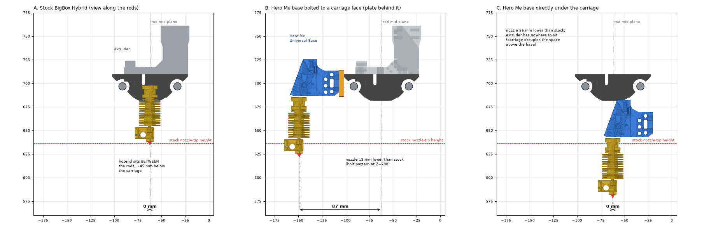
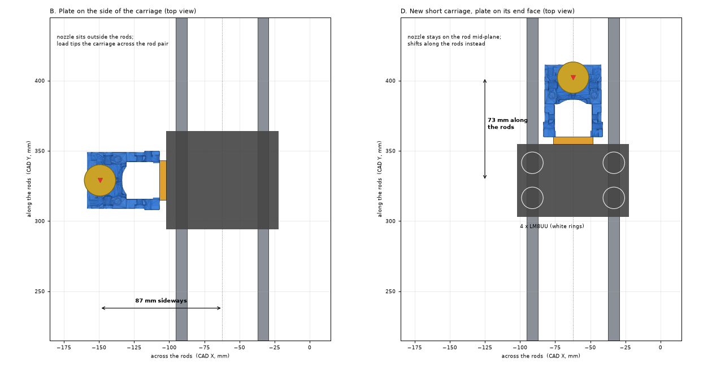
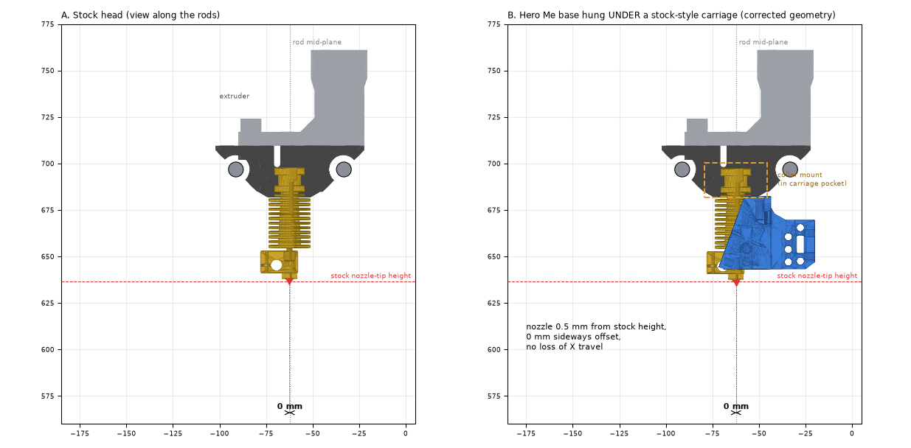
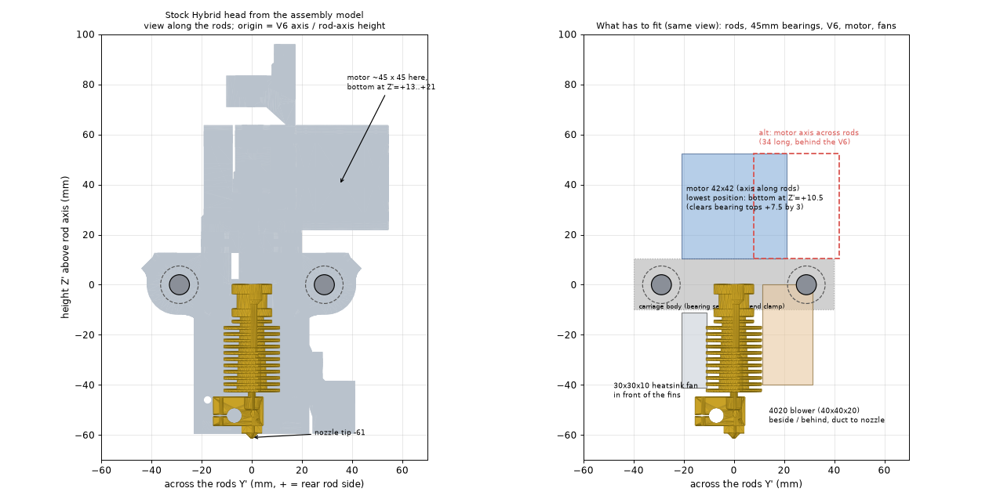

# Hero Me Gen7.4 (Release 4) Feasibility

Analysis of the Hero Me Gen7.4 printhead (Release 4, July 2023; docs "Read Me First V4.1", "Printer-Component Support V4.1", Change Log V1.6, plus the STL pack) against this printer.
Source files are not stored in this repo (STL pack is ~255 MB extracted); re-download from https://www.printables.com/model/39322.

## Verdict

**Probably yes, with one custom part.** Every component except the X-carriage mount is supported. The BigBox is not on the supported printer list (115+ models), so there is no ready-made *Gantry Adapter* for its X carriage. That adapter is the only piece that must be designed or adapted.

## Part-by-part

| Area | Current | Hero Me fit | Notes |
|---|---|---|---|
| Hotend | E3D V6, 1.75mm, 0.6mm nozzle | **Supported** | Base max hotend width 26.8mm; V6 fits. Use the *E3D V6 / Revo Six / Dragonfly BMO* **Collar Mount V3** + matching **Collar Skirt V2** (`Hotend Mounts/Hotends`, `Hotend Mounts/Skirts`). 1/1.5/2/2.5mm collar spacers are included for height tuning. |
| Heatsink fan | 30x30x10 24V axial | **Mismatch** | Hero Me heatsink fan is 4010 (or 4020) axial. Swap to a 4010 24V — this is already on the upgrade plan (3-wire tach 4010). |
| Part-cooling fan | 4020 blower, 24V | **Supported** | `Part Cooling Ducts/Standard Ducts/4020 fans` (Single 4020L/4020W, Left/Right V3; dual also available). "Long Ducts" and "Tall Ducts" variants exist for different nozzle protrusion. Duct clearance with a 0.6mm nozzle should be checked with `Options/HMG7 Duct Offset Check`. |
| Extruder | Hobb-Goblin gear on Wantai 42BYGHMB09L20P4.5-17-X (0.9°, 1.7A) | **Needs a supported extruder** | Hobb-Goblin is not in the list. Supported direct-drive options: Bondtech BMG (and clones), BMG-M, Orbiter 1.5/2.0, Sherpa Mini/Micro, Titan, LGX, etc. Whether the current extruder is carriage-mounted or Bowden should be confirmed; Hero Me is designed for direct drive but has a Bowden base cap/riser too (`Options/HMG7 Bowden Base Cap`, `6mm Bowden Riser`). Switching extruder changes `rotation_distance`. |
| Z probe | BTT Eddy Duo (was IR, bracket at x_offset -65) | **No dedicated mount** | Closest are the Beacon3D mounts (`ABL Mounts/Beacon3D ABL Sensor`; same flat-coil-PCB style sensor, 17-21mm mounts + spacers). Eddy Duo PCB dimensions differ from Beacon, so expect to adapt/design a bracket. Benefit: the probe would sit much closer to the nozzle than the current -65mm offset, restoring usable bed area. Re-run Eddy calibration after any move. |
| Accelerometer | none (planned ADXL345) | **Supported** | 14 mounts in `ADXL345 Mounts`. |
| Cable mgmt | -- | Optional | 22 towers/tubes in `Cable Management`. |
| X carriage | **unknown, needs measuring** | **Not listed** | See below. |

## The X-carriage question

Hero Me attaches to a printer through a *Gantry Adapter* (`Gantry Adapters/<brand>`) which bolts to the carriage and presents a standard interface to the *Base*. Options, in order of effort:

1. **Universal Base V2** (`Base/HMG7.2 Universal Base V2.stl`, 41.6 x 51.2 x 38.5mm) plus a custom adapter modelled to the BigBox carriage hole pattern. Precedent: `Seckit SK-GO` (also an unusual carriage) uses a custom base + adapter.
2. If the BigBox X axis is smooth rods with LM8UU-type bearings, the **i3 Clone 8mm Linear Rod** adapter or X carriage (`Gantry Adapters/Reprap i3 - Prusa- Clones`; adapter 40 x 28 x 12mm, carriage 22 x 66 x 52mm) may be adaptable or a good starting point. *Not verified that the BigBox matches this.*
3. Replace the carriage with a Hero Me-compatible one (also needs belt clamp design for the BigBox belt layout).

## What is needed to finish this

- Photos of the X carriage from front, back and top, with the hotend/extruder removed if possible.
- Measurements: X rod/rail diameter and spacing, carriage bearing type, mounting hole pattern and thread size, belt attachment style, and available Z clearance below the carriage.
- Confirm whether the extruder is currently on the carriage (direct) or elsewhere (Bowden), and its stepper body length.
- Hotend: actual nozzle-tip to carriage-mount distance, and whether the heater block is stock E3D V6 size.
- Confirm part-cooling blower model (some 4020 blowers differ in outlet width; L vs W duct variants depend on this).

## Klipper-side changes after a swap

- New probe `x_offset`/`y_offset` and `z_offset`; `bed_mesh` and `z_tilt` bounds in `printer.cfg` follow from the new offset. Eddy calibration must be redone.
- Extruder `rotation_distance` and pressure advance if the extruder changes.
- Possibly a new hotend fan config (4010 tach, see upgrade plan).
- Added carriage mass: re-run input shaping, ideally with the ADXL345.

## Addendum: findings from the BigBox STEP files

Source: `STEP.zip` (`Hybrid_v1.1.0.`, `bigbox_dual_v1.0.0`, `transit_brackets_1.1.0`, `bigbox_v1.1.0`, `BB_FRAME_M3_NUT_TRAP`), parsed with CadQuery/OCC. Numbers are read from the CAD geometry, not measured on the machine. Verify with calipers before printing anything.

- **Carriage (Hybrid, solid #1; 79.8 x 70.1 x 27.7mm):** two rod bores of ~15.4mm diameter on **8mm rods, 58.0mm apart**, horizontal, centred at the same height. Bore size suggests LM8UU-type (15mm OD) bearings.
- **Hotend positions:** two groove-mount bores (16.2-16.5mm, i.e. E3D V6 groove mount) at **38mm pitch**, centred exactly between the rods, seat plane ~15mm below the rod axis. The dual head file (`bigbox_dual`) has a longer 109.5mm carriage with the two positions at **35mm** pitch. The Hybrid uses its own carriage and leaves slot 2 empty; it is not the dual carriage.
- **Existing carriage mounting holes:** four 4.4mm holes in a ~26.7 x 38mm rectangle around the hotend seat (Hybrid). Candidate points to bolt a Hero Me adapter plate to; their purpose is unverified.
- **Transit brackets:** three 8mm rods ~497mm long; two line up with the carriage bores (58mm apart), plus end brackets. Confirms 8mm rods; otherwise not relevant to Hero Me.
- **Not in the CAD:** no nozzle or hotend body is modelled, so nozzle-tip height relative to the carriage is unknown. I did not establish which CAD axis maps to firmware X or Y.
- **Hero Me side (measured from the STL mesh):** the Universal Base V2 is 41.6 wide x 51.2 x 38.5mm. Its rear mounting pattern, shared by the gantry adapters, is 4 holes at **32.0 x ~12.4mm** (3.2-3.4mm in adapters, ~4.1-4.4mm in the base). The hotend holes in the base are 22mm apart and the fan holes 30mm apart.

### Implications

- Hero Me's standard interface is just a 32 x 12.4mm four-hole plate, so the custom piece can be a simple adapter. It needs to bolt to the BigBox carriage's underside (or replace the Hybrid carriage's hotend-clamp area) and put the Hero Me base centred between the rods.
- The Universal Base (41.6mm) fits inside the 58mm rod spacing, but only with ~42.5mm clear between bearing surfaces (58 - 15.4). Check clearance for the base, the duct wings and the heatsink fan against the bearing housings.
- The Hero Me stack is taller than the stock hotend. The probe, bed-level distances and the Z travel (250mm bed Z) need rechecking.
- The Hybrid's second hotend slot could carry a fan/duct, Eddy mount or ADXL345 if Hero Me replaces only slot 1.

### Still needed from you

Photos or measurements of the carriage underside and the actual bearing type, the nozzle-tip height below the carriage bottom, and whether the original carriage can be left in place.

## Addendum 2: V6, Eddy and accelerometer STEP files

Same caveat as above: read from CAD, not measured on the printer.

### E3D V6 (`e3d-v6-hotend` snapshot, 30x30x10 fan and stock duct included)
- Nozzle tip to top of heatsink: **61.2mm**. Heatsink 22.3mm diameter; the 16mm top flange (3.7mm) / 12mm groove (6mm) / 16mm lower flange match a standard groove-mount V6. Heater block 20 x 16 x 11.5mm.
- **Nozzle position in the Hybrid carriage (estimate):** if the V6 top sits at the bore step (CAD Z 697.6), the **nozzle tip is ~45.5mm below the carriage underside and ~60.4mm below the rod axis**. This is inferred from the carriage bore, not modelled; the stock duct bottoms in the dual-head file sit ~1.3mm below that point, which supports it. Confirm with a ruler.
- The V6 sits mostly inside the carriage between the rods (top of hotend roughly level with the rod axis).

### BTT Eddy (`Eddy_Bigtreetech.stp`)
- Envelope **18.9 x 17.0 x 33.8mm**, two solids (apparently two models of the same part, offset ~1.5mm). Two **3.3mm holes, 10.5mm apart**, 22.9mm from one end.
- The model is a chunky block, and I could not tell which face holds the coil. Confirm orientation and sensing face before designing the mount.
- Hero Me has no Eddy mount. Beacon3D mounts are the nearest, but this hole spacing (10.5mm) would need checking against them.

### BigTreeTech S2DW accelerometer
- Board **16.2 x 35.2mm**, 4.7mm tall including the USB-C connector at one end.
- Mounting: two **3.0mm holes 15.4mm apart** (at x=13.0, y=2.5 and y=17.9) plus a 6mm hole at (7.8, 20.3).
- Hero Me ADXL345 mounts (`ADXL345 Mounts`, 14 variants) are built for boards with **14.0mm** hole spacing (3.4mm holes). The S2DW's 15.4mm spacing does not match any of them. Options: slot the mount holes by ~1.4mm, or print a small adapter plate. The "35mm" mounts match the board length but not the hole spacing.
- Eddy Duo + S2DW both being USB devices on the Pi does not affect mounting, but cable routing and the Hybrid's free slot 2 are worth planning together.

## Addendum 3: Photos of the current head

- **Part fan:** label reads *Xinyujie XYJ24B4020H, DC24V 0.10A, ball bearing*, a standard **4020 radial blower**. Hero Me supports 4020 blowers (`Standard Ducts/4020 fans`, Single/Dual, Left/Right). The release has "4020L" and "4020W" duct variants; their meaning is not documented in the files, so measure the blower's outlet (and print one variant as a test) before committing.
- **Extruder:** the black printed extruder with spring-loaded idler sits directly on top of the carriage, so this is a **carriage-mounted direct drive** (the Bowden question is settled). The motor is above the frame of the photos. Hero Me's extruder mounts replace this piece; the Hobb-Goblin is still not on its supported list.
- **Hotend:** V6 hangs below the carriage with silicone sock, heatsink fins fully exposed, 30mm fan taped on the side. The stock duct outlet ends roughly level with the heater block bottom, consistent with the CAD-based nozzle estimate.
- **Duct condition:** the printed stock duct around the heater block looks partly melted/deformed. Worth replacing regardless.
- Both rods are 8mm bright steel; the carriage rides between them as in the CAD.

## Addendum 4: Community Eddy mount, ADXL comparison, height analysis

### Eddy mount (Printables/Thingiverse "Hero Me 7.4 BTT Eddy Mount, version TZ-V6-2.0", Juri, May 2024)
- Two parts: a **mount** (56 x 12.6 x 9.5mm, three M3 holes 6mm apart for attaching to the Hero Me body) and a **slide plate** (18.1 x 33.7 x 3.5mm) that holds the Eddy and adjusts in height. Plate holes for the Eddy are 10.5mm apart, which matches the Eddy STEP. STEP files are public so the mount can be adapted.
- Built for the **TZ-V6-2.0** hotend (a V6-form-factor clone); the E3D V6 is the same groove-mount form but the mount needs checking against the actual body and duct clearance.
- Author's assembly order: mount to the Hero Me body, set plate to ~2mm above the print plate, then fit the Eddy. M3x8 plate screw, M3x16 for the Eddy; hex screw heads must be <= 1.5mm tall (or thicken the plate).
- Coil end of the Eddy (confirmed by owner): the wider end, **farther from the mounting holes** (Z=0 end in the STEP, 22.9mm from the holes).
- License: CC BY-NC 4.0 (personal use fine, attribute the author).
- Expect the probe offset to drop well below the current -65mm, but the true value needs the assembled geometry.

### ADXL mounts vs S2DW
All 14 Hero Me ADXL345 mounts have **14.0mm** board-hole spacing (measured from the STLs). The S2DW STEP shows 15.4mm. No BTT ADXL345 2.0 model was available to compare, so the "same profile" claim is unverified. Measure the physical board's hole spacing; if it is 15.4mm, slot the mount holes or print an adapter.

### Height analysis (estimates; collar-mount orientation is inferred)
| | Stock BigBox Hybrid | Hero Me (Universal Base + V6 collar mount) |
|---|---|---|
| Nozzle tip vs reference | 60.4mm below rod axis; 45.5mm below carriage underside | ~63mm below base underside; ~76mm below the centre of the 32 x 12.5mm rear bolt pattern |
| Hotend position | centred between rods | **~42mm in front of the bolt plane** |

- The bolt-pattern centre sits ~13mm above the base underside. If it is placed level with the top of the Hybrid carriage (CAD Z 709.5), the nozzle ends up **~3mm lower** than stock: negligible. Placed at rod-axis height, it would be ~16mm lower.
- **The bigger issue is not height but lateral offset.** Stock puts the hotend between the rods; Hero Me's interface is a vertical plate with the hotend 42mm out in front. Bolted to a carriage face (carriage is ~79mm deep), the hotend would sit ~80mm off the carriage centre, far from the rods (leverage, shifted usable area). A custom bracket that keeps the base near the rod plane is needed, or a replacement carriage designed around the Hero Me interface.
- Confirm after any redesign: duct and Eddy plate clearance, bed clips, and Z home.

## Addendum 5: BIGTREETECH S2DW V1.0 manual

- Board is **33.25 x 15.5mm** per the manual (the STEP envelope of 35.2 x 16.2mm includes the USB-C overhang). Sensor is a **LIS2DW** on an **RP2040**, USB, 5V.
- Manual's mounting drawing confirms the STEP: holes **2.5mm and 18.0mm from the end** (**15.5mm apart**), plus the larger 6mm hole at 20.5mm. So the 15.5mm spacing is real and still does not match Hero Me's 14.0mm ADXL345 mounts.
- Two mounting methods shown (Voron StealthBurner example):
  1. On a side bracket with dual holes at the official spacing.
  2. Screws through the PCB and a rubber ring directly on the **heater block**. This needs no Hero Me ADXL mount, but the board is rated -40 to +85C and a V6 block runs 200C+, so only use it for short tuning runs, with the rubber spacer, and remove afterwards.
- Klipper: `[lis2dw]` section (added Aug 2023, update Klipper if "not a valid section"), RP2040 firmware (no bootloader offset, W25Q080 CLKDIV 2, USB), sample config `sample-bigtreetech-lis2dw-v1.0.cfg` at github.com/bigtreetech/LIS2DW. Set `axes_map` from the board's silkscreen axes vs printer motion.

## Addendum 6: BTT ADXL345 V2.0 manual and Hero Me ADXL holes

- The BTT ADXL345 V2.0 manual shows the **same board as the S2DW**: 33.25 x 15.5mm, mounting holes 2.5mm and 18.0mm from the end (**15.5mm apart**), 6mm hole at 20.5mm. Both boards share a footprint, so one answer covers both.
- **All 14 Hero Me ADXL345 mounts** were sliced and checked: every one has two round ~3.4mm board holes **14.0mm apart** (three rendered and inspected visually; no slots). None match 15.5mm.
- **The Hero Me bases do have ADXL holes**: the Universal Base V2 has two 3.0mm blind holes (~2.6mm deep), **~14.2mm apart**, on the base body. The DropEffect, Switchwire and Seckit bases and the Universal Skirt have similar pairs at ~14.0mm. These are the standard 14mm ADXL345 pattern and do not match 15.5mm either.
- **Options:** (1) a small adapter plate (14.0mm to Hero Me / 15.5mm to the board) or editing a mount STL to move the holes to 15.5mm; (2) the manual's heater-block method for short tuning runs only (board rated to 85C).

## Addendum 7: Gantry and base measurements, compatibility, positioning sketch

Schematic view along the rods (from the STEP and STL geometry; V6 shown with its fins and heater block only, no ducts or fans). A = stock; B = Hero Me base on a plate against a carriage face; C = Hero Me base directly under the carriage.

### Current gantry (from the CAD, not measured on the machine)
| Item | Value |
|---|---|
| Rods | 8mm, two, **58.0mm apart**, horizontal and level with each other |
| Carriage (Hybrid) | 79.8 (across the rods) x 70.1 (along the rods) x 27.7mm tall; bearing bores ~15.4mm |
| Hotend slots | 2, 38mm pitch, centred between the rods; V6 groove-mount bores 16.2mm |
| Clear room between the bearings | ~42.5mm (58 - 15.4) |
| Nozzle tip (est.) | ~60mm below the rod axis, ~45mm below the carriage underside |
| Rod end blocks | 72 x ~50-70 x 49mm; ~412mm clear between them, ~340mm of carriage travel |
| Carriage-to-rod fit | the two bearings force the carriage to be ~75-80mm across; it can't be made much narrower |

### Hero Me Universal Base V2
| Item | Value |
|---|---|
| Body | 41.6 wide x 51.2 deep x 38.5mm tall |
| Rear gantry interface | 4 holes, 32.0 x 12.5mm |
| Hotend axis | 9mm behind the front face, **42.2mm in front of the rear face**; hotend bolts to the underside with a 22mm hole pair |
| Extruder | mounts on the top (DD risers / extruder mounts) |
| Nozzle tip | ~63mm below the base underside with a V6 collar mount (est.) |
| ADXL holes | two 3.0mm blind holes, ~14.2mm apart |

### Compatibility summary
| Compatible with the BigBox as-is | Needs adapting | Not compatible |
|---|---|---|
| V6 collar mount V3 + collar skirt V2 (+ spacers), 4020 ducts (Single/Dual, Long/Tall variants), cable towers, Universal Base itself | 4010 heatsink fan (swap from 30mm), BMG-style DD extruder (replaces Hobb-Goblin), Eddy mount (community one, check on V6), ADXL mount (14 vs 15.5mm) | every Hero Me gantry adapter. The nearest, the i3-clone 8mm-rod carriage, has bores **~43mm** apart, not 58mm |

### What the sketch shows
- **A.** Stock keeps the heavy parts centred between the rods.
- **B.** A plate-mounted Hero Me puts the nozzle **~87mm from the rod mid-plane**, outside the rods, and the carriage cannot be narrower than the rod spacing, so this offset is hard to avoid with a "plate behind the base" design. Effects: a tipping load on the two rods, a shifted reachable area on the printer axis perpendicular to the rods (spare travel beyond the bed offsets some of it; check against your `position_max` values), and the extruder ends up on the base instead of on the carriage.
- **C.** Base under the carriage keeps the nozzle centred but drops it ~56mm and leaves no room for the extruder above it.
- Unverified: the Hero Me nozzle height (relies on the collar-mount orientation), and which printer axis (X or Y) runs along the rods.

## Addendum 8: Is there a Hero Me carriage that replaces the BigBox one?

**No.** Hero Me's rod-and-bearing carriages (`i3 Clone 8mm/10mm Linear Rod X Carriage`, `Anycubic i3 Mega S X Carriage`, `Anet A8 Plastic X Carriage`) all put the two bearings **~45mm apart** (Prusa-i3 style), measured by fitting circles to the STL cross-sections. The BigBox rods are 58mm apart. Everything else in `Gantry Adapters` bolts to a printer's existing carriage, or uses MGN rails, V-wheels or Wham Bam/PrinterMods hardware. A new carriage has to be designed. The Hero Me side of it is simple: it only needs the 32.0 x 12.5mm four-hole pattern on a flat face.

### Design target for a new carriage
- 2 x 8mm rods at 58.0mm; 4 x LM8UU (15mm OD, 24mm long) or 2 x LM8LUU; belt clamp; endstop flag if used.
- Minimum footprint is roughly **79 across x ~52 along the rods x ~22 tall**, versus 79.8 x 70.1 x 27.7 for the current Hybrid carriage: narrower is not possible, shorter is.
- Rough plastic volumes (solid, ignoring infill): current carriage 66 cm3; Hero Me base 24.6 + V6 collar mount 6.9 + skirt 3.1 + one 4020 duct 11.6 = ~46 cm3, plus the new carriage (est. 20-30 cm3) and an extruder mount. Real weight savings depend mostly on the extruder and motor: a geared extruder (BMG, Orbiter, Sherpa Mini) allows a lighter motor than the current ungeared Hobb-Goblin on a full-size NEMA 17 and still keeps direct drive.

### Two ways to orient the plate

| | B. Plate on the side face | D. Plate on the end face (along the rods) |
|---|---|---|
| Nozzle | **87mm** to the side of the rod mid-plane | stays **on** the rod mid-plane, **~73mm** ahead of the carriage centre along the rods |
| Effect | load tips across the rod pair; shifts reach on the perpendicular axis | loses travel along the rods at one end (the base sticks out ~56mm beyond the carriage), against ~340mm of travel for a ~300mm bed |
| Fit | n/a | the base (41.6 wide) sits between the rods (~50mm clear); ducts hang far below the rods |

D keeps the nozzle on the rod mid-plane, which matches how the stock head is balanced, and is the better starting point. Bearing span along the rods (~52mm carriage) versus a ~73mm lever arm is the thing to watch: a longer carriage (LM8LUU, ~60-70mm) is cheap insurance. Check before committing: the exact travel loss at the end block, which printer axis runs along the rods, and clearance between the base and the end block.

## Addendum 9: Rod and bearing specs from the manual; belt and travel check

**Specs (from the E3D manual, per owner):** rods `rod-G.H.SS-8-484`, 8mm x 484mm; bearings `LM8LUU`, 8mm ID x 15mm OD x **45mm** long.

- **CAD agrees.** The stock carriage has 15.44mm bores with a **45mm bearing seat** on each rod, so it uses **one LM8LUU per rod** (2 bearings total, not 4). The rods are 484mm, ~412mm of which is clear between the end blocks, so ~36mm of each rod sits inside an end block.
- **New carriage length:** 45mm bearing + ~3mm wall each end, so **~51mm** along the rods (stock is 70.1mm). Keep the LM8LUU: one long bearing per rod resists tipping better than two short ones. This supersedes the "4 x LM8UU" assumption in Addendum 8.
- **Belt clamp is on the carriage end faces, between the rods, at about rod-axis height** (M3 holes at X = -50/-75/-69, Z = 692-703, drilled along the rods; the photos show the belt entering at that height). A Hero Me plate on an end face (option D) would sit in the belt's path.
  - Fix: put the bolt pattern **above the belt**, at Z >= ~719 (rod axis 696.8, so ~22mm above it). Base underside is then ~706, and the nozzle tip ends up **~6mm higher than stock** (~643 vs 636). The carriage then needs a taller "tower" on the plate end, and both belt clamps stay on the lower part of the end faces. Measure the real belt height to confirm.
  - Option B (side plate) does not touch the belt but has the 87mm sideways offset.
- **Travel check for option D** (positions measured along the rods from the rear end block's inner face; estimates from CAD):
  - Stock: carriage 70.1mm, nozzle at the centre, nozzle reach ~35 to ~377mm (342mm window).
  - Option D: carriage 51mm, base overhangs the front by ~56mm, nozzle ~73mm ahead of the carriage centre. Nozzle reach ~98 to ~403mm (305mm window).
  - A 300mm axis still fits in 305mm, but the window moves ~63mm toward the base side, so the bed-edge position decides what is lost: roughly **20-60mm at the rear end** unless the rear end block is shortened or moved. Needs the real bed position and which printer axis runs along the rods.

## Addendum 10: Axis correction (owner)

Correction from the owner: **the rods the nozzle rides on are the X axis** (the CAD files are oriented arbitrarily, so I could not infer this). The Y axis has the gear and belt assembly and moves the whole X gantry on its own rods and bearings. Earlier "along the rods" = X, "across the rods" = Y.

Consequences:
- **Option D (plate on the carriage end face, nozzle ~73mm ahead along X)** only shifts the nozzle along X and leaves Y reach unchanged. Spare X travel: ~342mm of carriage travel for a 300mm bed (`position_max: 300`), so there is ~42mm to spare in stock.
- **Option B (plate on the side face)** puts the nozzle ~87mm off in **Y**. Y has `position_max: 245` for a 200mm bed (~45mm spare), so B would cost at least ~40mm of Y reach, and the load would tip across the rod pair and load the Y gantry bearings too. D is the better option.
- **Which end gets the plate matters.** The nozzle gains reach on the plate side and loses it on the other. Loss on the far side = ~98mm minus the bed margin on that side (stock margin there is 35-77mm), i.e. ~20-60mm. Put the plate on the end where the bed edge is **closest** to the end block, so the loss falls on the side with more margin.
- To recover reach, the rod end blocks (printed) could seat the 484mm rods less deeply (~36mm now), adding up to ~30mm of clear span.
- Needed to quantify: with the carriage at the X home position and at X max, the gap from the carriage end to each end block.

## Addendum 11: Full assembly model (ConnorM2009, Thingiverse 5183700) and a correction

Source: `E3D Bigbox - 3D Model` (CC BY-NC), `Assembly_Bigbox_Hybrid_v2.step` / `Assembly.stl`, which includes the frame, rods, Hybrid head and electronics but no belts, fasteners or wires. Measured from the STL triangles; the part names list `LML8UU` bearings (= LM8LUU), `Rod X 484`, and `Hybrid_v1.1.0. X Carriage` with bearing traps, fan mount, IR mount and extruder arm.

### Real X-axis numbers
| Item | Value |
|---|---|
| X rods | two, 8mm, **57.8mm apart**, axis height Z=524.5 in that model's frame; ~482-484mm long |
| Clear span between the X end blocks | **~406mm** |
| Stock head length along X (carriage + two bearing traps + extras) | **~94-102mm** |
| Stock head travel | 406 - ~100 = **~304-312mm**, i.e. almost exactly the 300mm `position_max`: **there is essentially no spare X travel** (this replaces the "~42mm spare" figure above) |
| Nozzle tip | **61.2mm below the rod axis** (matches the earlier 60.4mm estimate) |

### Correction to the Hero Me height model
Addenda 4 and 7-10 assumed the V6 hangs **~63mm below the Hero Me base**. That was wrong. Evidence now: the V6 collar mount (40 x 34 x 18.4mm) screws to the **top** of the base with a **30.0mm bolt pair** (same spacing as the base's top holes); the heatsink fins and fan sit **inside** the base; the nozzle protrudes only **~7.5mm below the base underside**. The ducts also hang ~6mm below the base, consistent with this. So the nozzle is ~22mm below the base's rear bolt-pattern centre, not ~76mm. (Still inferred from STL geometry, not from a Hero Me assembly file.)

### New best option: hang the base UNDER a stock-style carriage

- Keep a carriage like the stock one (bearings at rod level, flat underside at the stock plane, ~Z 682 in the earlier frame) and bolt the Hero Me base under it with the collar mount sitting in a pocket in the carriage (pocket 34mm across the rods x 40mm along them, ~19mm deep, leaving ~4mm walls to the bearing bores).
- Result: hotend **centred between the rods, 0mm sideways offset**; nozzle within **~0.5mm of stock height**; the base footprint stays inside the carriage footprint, so **no loss of X travel**. This removes the 87mm-offset and 73mm-travel-loss problems of options B and D.
- The extruder mounts above the carriage as it does now (filament drops through a bore into the V6 top). Hero Me's DD extruder mounts are made to bolt onto the collar mount/base top, so they would need adapting or replacing with a simple carriage-top mount.
- Carriage length along the rods can be well under the stock ~100mm: 45mm LM8LUU per rod plus walls (~51-60mm) holds the 40mm collar mount and base.
- Still to design/check: belt clamps and tensioner slot, X endstop microswitch (the stock ones are on the printhead per the build manual), IR/Eddy mount position, 4020 duct clearance to the rods, and the exact pocket and base-top screw geometry against the real Hero Me parts.

## Status and how to resume (saved 2026-10-27)

**Where we are:** Hero Me Gen7.4 has no part for the BigBox's 58mm two-rod carriage, so a new carriage must be designed. Best current plan (Addendum 11): a short stock-style carriage (2 x LM8LUU on 8mm rods, 58mm apart, ~51-60mm long, no longer than the stock ~100mm head) with the Hero Me Universal Base hung **under** it, the V6 collar mount in a pocket (34 across x 40 along the rods, ~19mm deep), extruder on top. Hotend stays centred and at stock nozzle height. Addenda 7-10 are partly superseded by 11 (the V6 height model was wrong).

**Open items:** belt clamps and tensioner slot, X endstop microswitch (both on the stock printhead), Eddy mount position (community mount in Addendum 4), extruder choice/mount (Hobb-Goblin is not Hero Me supported; BMG/Orbiter/Sherpa Mini), 4020 duct choice (L vs W), 4010 heatsink fan swap, accelerometer mount (S2DW / ADXL345 V2.0 holes are 15.5mm, Hero Me's are 14.0mm), real measurements to confirm the CAD-derived numbers.

**Not in the repo:** the downloaded Hero Me STL pack, the BigBox STEP files and the assembly model (large; re-download from Printables 39322, the E3D BigBox parts, and Thingiverse 5183700).

**Scripts:** `hero-me-analysis-scripts/` has the Python used for the measurements (needs `cadquery`, `trimesh`, `numpy`, `matplotlib`, `py7zr`, `pypdf`; STEP/STL paths are hard-coded to the scratch layout used in this session).

## Addendum 12: E3D BigBox Dual Titan IDEX (alex9779, Thingiverse 2350827, CC BY-NC) as inspiration

Parts analysed from the STLs and gallery images (no assembly file). It is a fixed (no cartridge) IDEX head for the BigBox with horizontally laid Titan extruders, BLTouch or IR probe, blower ducts and IGUS Series 4 drag-chain anchors.

**Same hardware, different gantry geometry.** The carriage bores are 15.5mm and the bearing clamps are exactly 45mm long, so it uses the same **8mm rods and 45mm LM8LUU** bearings as the stock machine. But each carriage cradles its two bearings in a **diagonal/stacked arrangement only ~30mm apart** (read from cross-section fits of the carriage and clamp STLs, and the gallery shows separate rod pairs per head), not the stock 57.8mm side-by-side pair. It cannot be dropped onto the stock rods; the Y-axis idler/clamp parts are also redesigned. Confidence is moderate: no assembly file was available to confirm the rod layout.

| | IDEX carriage (per head) | Stock Hybrid carriage | Our Hero Me plan (Addendum 11) |
|---|---|---|---|
| Along the rods | **45mm** (= bearing length) | 70mm carriage, ~100mm with bearing traps | ~51-60mm |
| Across / tall | 72.5 x 39-43mm | 79.8 x 27.7mm | ~79 x ~28mm |
| Printed volume | carriage ~26 cm3 + 2 clamps ~23 cm3 | carriage 66 cm3 + traps | carriage est. 20-30 cm3 |

**Worth borrowing**
1. **Clamp-style bearing seats.** The bearing drops in from the side and a 45 x ~30 x 17mm printed clamp closes it; no pressing in, easy to replace, and the carriage is exactly bearing-length long.
2. **Integrated belt clamp "combs"** in the carriage bottom, with belt-side and idle-side variants and a belt clearance already adjusted by 2mm (Update 2). A direct model for our belt clamp and tensioner problem.
3. **Open front around the hotend** for installation and cabling, instead of a closed pocket.
4. **Horizontally laid extruder motor**, which lowers the head and allows short NEMA14s (author suggests a 14HS20-1504S, 52mm, 40 Ncm, similar torque to the stock X motor) or NEMA17s. Hero Me supports the Titan too (E3D-Online Titan mounts), but we do not have one.
5. **Probe as close to the hotend as possible** (30 x 15 x 33mm mount): the same goal as bringing the Eddy near the nozzle.
6. **IGUS Series 4 chain anchors** if a drag chain for the head cabling is wanted.

**Not transferable:** the rod layout, the Titan-specific mounts, the 5015-style blower ducts and BLTouch ducts, and anything dual-head.

## Addendum 13: Design brief v0 for a custom compact carriage (supersedes the Hero Me base plan)

**Decision (owner):** keep the **E3D V6, the 30x30x10 hotend fan, the 4020 24V blower, the stock NEMA17 pancake direct-drive extruder (Hobb-Goblin + spring idler) and the existing X/Y motors and belts**; stay **direct drive**. Drag chains are optional. IDEX is a stretch goal. Alternative proposal allowed: rearrange the rods like the IDEX design.

**Consequence:** Hero Me's base is built around a 4010 heatsink fan and its extruder mounts do not include a Hobb-Goblin, so with those parts fixed it is no longer a good fit (Addendum 11 is retired as the plan). Hero Me/IDEX remain design references only.

Sources used: the crawled wiki manual (`bigbox-manual/`, read only), the full assembly model (head extents and V6 axis), the STEP files, the Hero Me and IDEX parts. The crawl has no Hybrid direct-extruder pages (listed in its `MISSING.md`), so the stock idler/extruder arm geometry comes from the CAD only.

### Measured from the stock head (assembly model)
- V6 axis is centred between the rods (rods 57.8mm apart); nozzle tip 61.2mm below the rod axis; V6 top at rod-axis height.
- Head extends 57mm to one side and 45mm to the other of the nozzle along X, ~102mm total: that is why the manual says the Hybrid needs a case cut (or the "lifted" carriage) to reach the full 300mm.
- Motor/idler block sits at Z' +22 to +63 above the rod axis, behind the V6. Hobb/filament line ends ~43mm above the V6 top.

### Design rules
1. **Carriage <= 50mm long along the rods, nozzle on its centre.** With ~406mm clear between end blocks the nozzle then reaches ~356mm, so a full 300mm needs no frame cutting and leaves ~25mm spare each side.
2. **Same rod and bearing hardware:** 2 x 484mm 8mm rods, one LM8LUU (45mm) per rod, clamp-style bearing seats like the IDEX parts, 57.8mm spacing.
3. **Motor as low as the geometry allows.** The 42mm-wide motor cannot sit between the bearings (only ~42.5mm of clear room), so its underside must clear the bearing tops: lowest Z' = +10.5 versus +22 stock (~11mm lower, filament path ~31mm instead of ~43mm). Two orientations to evaluate: axis along the rods, or axis across the rods like stock.
4. **Fan placement under the carriage:** 30x30x10 heatsink fan in front of the fins (below the bearing level, so it adds nothing to the head length); 4020 blower beside/behind with a duct to the nozzle.
5. **Belt:** belt-side and idle-side variants, integrated belt-clamp comb (as in the IDEX carriage), plus the tensioner and X microswitch features the stock head has (per the manual's commissioning page).
6. **Probe:** the Eddy (and IR) mount on the carriage as close to the nozzle as possible.
7. **Optional:** M3 anchor points for a generic drag chain; nothing requires it.

### Stretch goal: IDEX
Klipper supports it (`[dual_carriage]`). With two <=50mm carriages and centred nozzles, both heads can reach a full 300mm: head A reaches ~111..411, head B parks at ~436+, and B's centre can go to ~467, so it fits with only ~6mm of slack. It needs a second X motor, belt and endstop, a second hotend/extruder and blower, plus mirrored carriage variants. Designing the carriage as a mirrorable left/right pair now costs almost nothing.

### Alternative B: IDEX-style rods (~30mm apart)
Gives a narrower carriage but needs reprinted end blocks and a rerouted belt, changes the nozzle-to-rod relationship, and the rod layout could not be confirmed from the files. Not the first choice.

### Plan
1. Carriage core: bearing seats and clamps, belt comb, V6 groove clamp (parametric, with a test print of the seats). 2. Extruder motor/idler mount. 3. Heatsink fan, blower duct, Eddy mount, microswitch. 4. Optional chain anchors. 5. Mirrored IDEX variant.

### Needed from the printer
Motor body length; idler arm and spring design; belt height above the rod and how it is clamped; X home margin to the end block; V6 fan side; Eddy offset target.

## Addendum 14: Clarifications (owner)
- **Extruder motor:** Wantai `42BYGHMB09L20P4.5-17-X` (from `printer-spec-sheet.md`; same as X and Y), 0.9deg, 1.7A, 400 full steps. Klipper `rotation_distance: 22.694` for the extruder means an effective hob diameter of ~7.2mm at 1:1, i.e. a bare Hobb-Goblin on the motor shaft (ungeared). The model number does not give the body length and a web search did not find the datasheet: **measure the body length** (flange face to rear) with calipers. Rough guess only: ~40mm class given the torque.
- **V6 fan** is on the right now but the clip can be rotated, so its side is a free design choice (front of the fins is the plan).
- **Correction on Hero Me and direct drive:** Hero Me does support direct drive, with extruders on its list (BMG, Orbiter, Sherpa, Titan, LGX, the Creality/MK8-style single gear and others). What it does not have is a mount for the BigBox's own printed extruder (bare Hobb-Goblin on the motor with a printed idler arm and spring). Using Hero Me would therefore mean swapping the extruder body for a supported one **and** the 30mm hotend fan for a 4010 (its base only supports 4010/4020 heatsink fans), and the carriage/adapter for the 58mm rods has to be custom either way. With the motor, hotend and fans fixed, that leaves little reason to use the Hero Me base, which is why the brief went custom. If those two swaps become acceptable, Hero Me could be revisited.

## Addendum 15: Extruder and fan decisions (owner)
- **Extruder:** reuse the BigBox's own design (stock motor + bare Hobb-Goblin + printed idler arm, spring and filament guide). Source geometry is in the Hybrid STEP (`Extruder Top Arm`, `Filament Guide`, `Printed Extruder Top Plate`). The stock top plate is ~71mm long along the rods, so it will need reworking to fit the <=50mm carriage rule, but the motor/hob/idler arrangement stays. The stock carriage's top hole pattern for the extruder plate is ~26.7 x 38mm.
- **Hotend fan:** changing it is acceptable; the owner wants a **3-wire tach fan** so Klipper can detect failure (already on the upgrade plan: `tachometer_pin` plus Ellis' `fan_tach_monitor.cfg`; tach on a spare input such as Z-MAX/PC5, since X-MAX/Y-MAX are earmarked for the runout sensor).
- **Open inconsistency:** the spec sheet and the E3D BOM say the hotend fan is **30x30x10**, but the upgrade plan calls it a "4010". Measure the fan. If the new fan is a **4010 (40x40x10)**, Hero Me's base and ducts become usable again (it supports 4010/4020 heatsink fans), so the carriage could carry the Hero Me base under it (Addendum 11) with the BigBox extruder on top. If it stays 30x30, the fully custom route applies.
